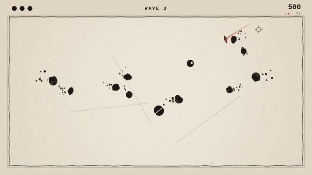

# Recall

A small arcade game about one blade that always comes back.



You have one throwing blade. Throw it, call it back early if you need to, and catch it: every catch after a hit raises your score multiplier, and every empty catch while enemies are on the board drops it. Everything you kill leaves ink on the floor, so each run ends as a painting you can save.

**Play:** in the browser on itch.io *(link added after upload)*, or run it locally:

```bash
git clone https://github.com/FishRaposo/recall.git
cd recall
npm start            # serves the folder at http://localhost:8080
```

Any static server works (`python -m http.server` too). Opening `index.html` straight from disk won't, because browsers block ES modules on `file://`.

## Controls

| | Mouse + keyboard | Keyboard only | Gamepad |
|---|---|---|---|
| Move | WASD | arrows | left stick |
| Aim | mouse | follows movement | right stick |
| Throw / recall | left click | Z or space | A, RB or RT |
| Dash | right click or shift | X | B, LB or LT |
| Pause · mute · fullscreen | esc · M · F | esc · M · F | start |

## How it plays

- **The blade is your only weapon and your only combo meter.** While it's out you can't attack, so every throw is a commitment. Recalling early is a second attack: the blade cuts on the way back too.
- **Five enemies, introduced one per wave** with a one-line note on the wave banner: mites swarm, darters telegraph a straight lunge, splitters break in two, spitters keep their distance and fire ink you can cut out of the air, brutes take three hits and slow the blade down.
- **Nothing is unfair on purpose.** Enemies fade in for 0.75 s before they're solid and never spawn within 200 px of you; darters lock their aim and draw the line before they move; spitters glow before they fire.
- **Every third wave restores a heart.** Every fifth wave is heavy on brutes.

## Under the hood

No engine, no dependencies, no asset files: about 2,100 lines of plain JavaScript on a 2D canvas.

- **Game feel is code you can read.** Hitstop on every hit (the simulation freezes for 40 to 120 ms while the camera keeps shaking), trauma-based screen shake, squash on the player, hit flashes, a trail on the blade, and a hit sound that climbs a semitone per enemy struck in one throw, so a long chain sounds like a scale.
- **Sound is synthesized at runtime** with WebAudio: oscillators and filtered noise, no audio files.
- **Inputs are buffered for 150 ms**, so a click made during hitstop still throws when the frame resumes.
- **Swept collision.** The blade moves up to ~17 px per frame; enemies are tested against the segment it travelled, not its position, so it never tunnels through a small enemy.
- **Frame-rate independent smoothing** (`expDecay`) for movement and steering: the game plays the same at 30, 60 and 144 Hz, and there's a test that checks it.
- **Seeded randomness.** Wave composition and spawn positions come from a seeded PRNG; `?seed=123` replays the same run layout. `?debug` shows fps, entity counts and the seed.
- **The floor is a second canvas.** Kills, dashes and wall bounces stamp ink into it, and **S** on the game-over screen exports it as a PNG.

The design reasoning and the bug that almost shipped are in [docs/DESIGN.md](docs/DESIGN.md).

## Project layout

```
index.html        page shell
src/main.js       game loop, states, collision, scoring, rendering
src/player.js     movement and dash
src/blade.js      the blade's out / return / held state machine
src/enemies.js    the five enemy types
src/waves.js      wave composition (pure, unit-tested)
src/fx.js         shake, particles, ink layer, floating text, paper background
src/audio.js      synthesized sound effects
src/input.js      keyboard, mouse and gamepad behind one interface
src/ui.js         HUD, title, pause and game-over screens
src/config.js     every tunable number in one place
test/             node:test suites
```

## Tests

```bash
npm test         # 18 tests: blade homing at 30/60/144 fps, wave budgets, collision, RNG
npm run check    # syntax check of every module
```

The browser-side modules were also exercised by scripted headless play-throughs (one with player damage switched off, reaching wave 7) with no console errors.

## Limitations

- No touch controls yet: it needs a mouse, keyboard or gamepad.
- Controls can't be rebound.
- Tested in Chromium. Firefox and Safari should work (it uses only standard canvas and WebAudio APIs) but haven't been verified.
- Sound starts after the first click or key press, because browsers block audio until the page gets a user gesture.

## License

[MIT](LICENSE)
